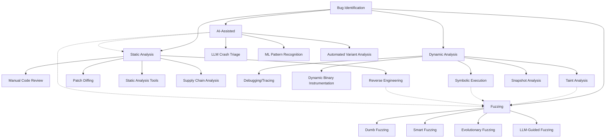

## Overview

Bug identification is the process of discovering potential vulnerabilities in software through various techniques including static analysis, dynamic analysis, and fuzzing. This document outlines methodologies and tools for effective vulnerability research.

For practical exploit development, see [Exploit Development](/exploit/development.md).

