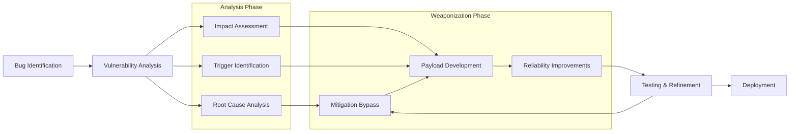

## Exploit Development Process

- Checkout [Bug Identification](/exploit/bug-identification.md) document for more information
- Also check [Fuzzing](/exploit/fuzzing.md) for specific fuzzing topics
  - Integrate snapshot‑based fuzzing pipelines (AFL++, WinAFL, Snap‑Fuzz) and LLM‑guided input mutation to shorten time‑to‑bug.
  - Incorporate LLM‑assisted fuzzers (ChatAFL, HyLLFuzz) for grammar inference or plateau escape when grey‑box coverage stalls.
  - Add continuous‑integration security fuzzing (e.g., GitHub Actions with ASAN/UBSAN) so regressions are caught automatically.
- For Windows-specific vulnerabilities, see [Windows Kernel](/exploit/windows-kernel.md)

