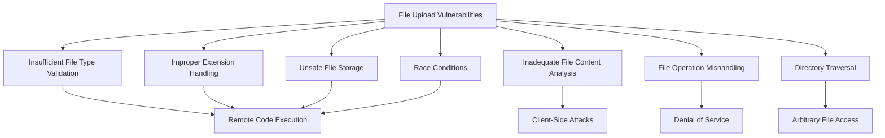

## Mechanisms

File upload vulnerabilities occur when web applications allow users to upload files without implementing proper validation, filtering, and handling mechanisms.
These vulnerabilities can lead to various attacks, ranging from simple web defacement to complete server compromise through remote code execution.

The core technical issues behind file upload vulnerabilities include:

- **Insufficient File Type Validation**: Failure to properly validate the actual content/type of uploaded files
- **Improper Extension Handling**: Not restricting dangerous file extensions or allowing easy bypasses
- **Inadequate File Content Analysis**: Not checking the actual file content versus relying only on extension or content-type
- **Unsafe File Storage**: Storing files in executable directories or with dangerous permissions
- **File Operation Mishandling**: Not securely handling file operations during the upload process
- **Directory Traversal Vulnerabilities**: Allowing manipulation of upload paths
- **Race Conditions**: Timing issues during validation and moving of uploaded files
- **Archive Extraction Flaws**: Insecure handling of archive formats like ZIP or TAR (e.g., Symlink abuse, Zip Slip)

File upload vulnerabilities can manifest in various upload functionality patterns:

- **Profile Picture Uploads**: Common in user profiles and social media
- **Document Repositories**: File sharing services and document management systems
- **Media Uploads**: Image, video, and audio uploaders
- **Bulk Import Features**: CSV, XML, and other data import functionality
- **Content Management Systems**: Templates, plugins, themes, and media libraries

