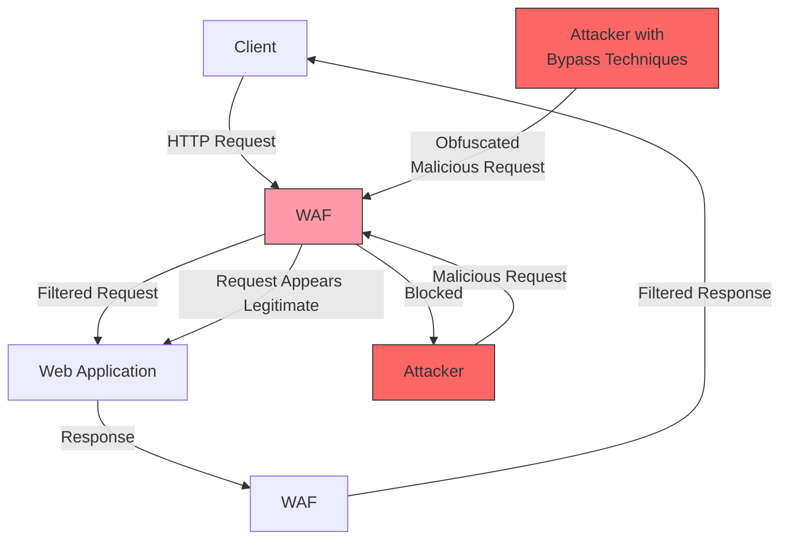

## Full Methodology

# WAF Bypass Techniques

A Web Application Firewall (WAF) is a security tool that protects web applications from various attacks by analyzing HTTP requests and applying rules to identify and block suspicious traffic. This document outlines effective techniques to bypass WAF protections during security assessments.

