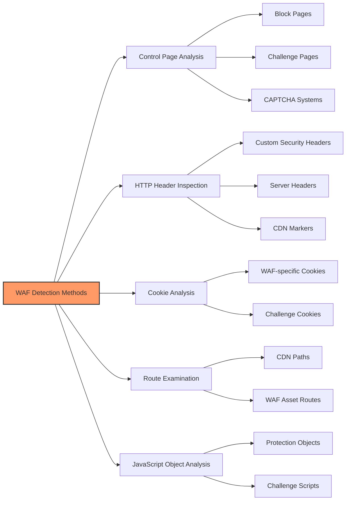

## Detection Methods

1. **Inspect Control Pages** - Many WAFs display specific pages when blocking access
2. **Analyze HTTP Headers** - Check response headers for WAF-specific indicators
3. **Examine Cookies** - WAFs often set specific cookies (e.g., cf_clearance for Cloudflare)
4. **Look for Specific Routes** - e.g., /cdn-cgi/ for Cloudflare
5. **Check JavaScript Objects** - WAFs inject specific JS objects (e.g., `\_cf_chl_opt`)
6. **JA3/JA4/TLS Fingerprints** - Compare your client’s TLS fingerprint with common browser fingerprints; mismatches are often blocked.
7. **HTTP/2/3 Support** - Identify protocol negotiation; some WAF policies differ by protocol.

### Fingerprinting WAFs

Some specific fingerprints of common WAFs:

- **Apache Generic**: Writing method type in lowercase (e.g., `get` instead of `GET`)
- **IIS Generic**: Using tabs before method (e.g., `    GET /login.php HTTP/1.1`)
- **Cloudflare**: Challenge pages with JavaScript verification
- **ModSecurity**: Specific error messages and block pages
- **AWS WAF**: AWSELB cookies and specific headers
- **Fastly Next‑Gen WAF**: `fastly-debug-*` headers (when enabled), service IDs in responses
- **Cloudflare Bot Fight Mode/AI WAF**: presence of Turnstile, managed challenge flows, Bot Management headers

