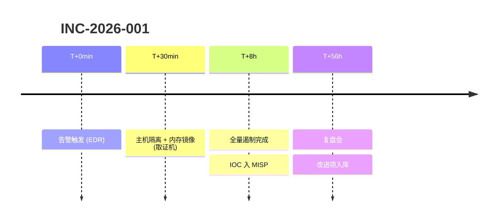

# 情报驱动狩猎 + IR/SOC 响应平台化参考

> 上游来源：`28-威胁狩猎/威胁狩猎方法论-ThreatHuntingMethodology.md`(28-001)、`网络流量与日志异常检测`(28-004)、`31-SOC运营/SOC事件分级与响应流程`(31-002)、`安全自动化与编排-SOAR`(31-003)、`15-应急响应/事件复盘与报告`(15-004)、`30-数字取证/磁盘镜像与证据获取`(30-001)。
> 标注：**【实测】**=本机跑通/已核对真实返回；**【上游】**=保留上游、未复测；**【补充】**=本卡新增；**【未验证】**=需目标环境复测。
> 取证方法论不重复：磁盘/内存/浏览器取证看本库 `digital-forensics`、`traffic-analysis-pcap`、`host-ir-check`、`incident-response`、`malware-analysis`。

## 1. 狩猎假设生成与 PDCA 落地

假设的四个来源【上游 28-001】：① 威胁情报（新 APT 用 T1055 → 假设本环境存在同类行为）；② 数据分析（DNS 查询量突增 300% → 假设存在隧道）；③ 已知漏洞（Log4j 爆发 → 假设内网有扫描/利用尝试）；④ 红队反馈（红队 Kerberoasting 成功 → 假设真攻击者也会用）。

假设文档字段【上游】：`id / title / source(threat_intel|data_driven|vuln|red_team) / mitre_technique / hypothesis / data_sources / indicators / validation / status`。

PDCA【上游骨架 + 本卡补充真实查询】：

- **Plan**：定目标（如"横向移动"）→ 选数据源（EVTX/网络/EDR）→ 写 IOC 与判据。判据必须先写"命中即真"与"命中即假"两种情况，否则 Check 阶段无标准。
- **Do**：跑查询（下）。【补充】先跑一次 `| stats count` 摸清基线量级，再下结论。
- **Check**：真/假阳性判定 → 跨源关联 → 时间线重建（见 §7）。
- **Act**：把确认模式转成检测规则（Sigma → SIEM）、更新告警、出狩猎报告。

```splunk
# 异常 RDP 登录（LogonType 10）【上游 28-001】
index=windows EventCode=4624 LogonType=10
| stats count by Account_Name, WorkstationName, IpAddress
| where count > 10
| eval severity=if(count > 50, "critical", "high")
| sort -count

# 同一源 IP 登录多个账号【上游 28-001】
index=windows EventCode=4624
| stats dc(Account_Name) as user_count by IpAddress
| where user_count > 5
| eval alert="multiple_users_single_source"
```

```bash
# Elastic：横向移动线索（LogonType 3）【上游 28-001；字段名随 ECS 映射而异，未验证】
curl -s -X POST "localhost:9200/_search" -H 'Content-Type: application/json' -d '{
  "query": {"bool": {"filter": [
    {"term": {"event.code": "4624"}},
    {"term": {"logon.type": "3"}},
    {"range": {"@timestamp": {"gte": "now-7d"}}}
  ]}}}' | jq '.hits.hits[] | {user: ._source.user.name, ip: ._source.source.ip}'
```
注意【未验证】：上游注释写"Elastic EQL"，给的却是普通 `_search` DSL —— EQL 需走 `POST /<index>/_eql/search`，两种语法不通用；跑之前先确认字段是 `keyword` 还是 `long`（`logon.type` 常被映射成数值，`term` 匹配会失败）。

- 成熟度【上游 28-001】：HMM 0 仅自动化告警 → 1 基于 IOC 搜索 → 2 基于 TTP 分析 → 3 自定义数据模型 → 4 预测性/自动化。
- KPI【上游】：狩猎循环时间、真阳性率、ATT&CK 覆盖率、狩猎转化率（狩猎结果→检测规则的比例）。
- 狩猎报告表结构【上游】：时间 / 主机 / 用户 / IOC / 可信度 / 操作（隔离·调查·忽略）+ 真阳性数、误报数、转化规则数。做平台化时这些字段直接落 TheHive case 的自定义字段与 task（见 §4）。

## 2. DNS 隧道检测（可跑命令）

```bash
# 采集【上游，但 zeek 脚本名有误】：zeek 的 DNS 日志默认开启，不必追加脚本名
zeek -i eth0 -C                 # 上游写作 `zeek -i eth0 -C dns`，该脚本名在 Zeek 5+ 会报 no such script
zeek -r capture.pcap -C         # 离线分析；上游的 `zeek -r capture.pcap dga` 依赖第三方 zeek-dga 插件【未验证】
tcpdump -i eth0 -n -s0 -w dns.pcap 'udp port 53'
tcpdump -r dns.pcap -n 'udp port 53 and greater 200'    # 找大 DNS 报文（隧道特征之一）
```

```bash
# Zeek dns.log 字段（官方顺序）：ts uid id.orig_h id.orig_p id.resp_h id.resp_p proto trans_id rtt
#                               query qclass qclass_name qtype qtype_name rcode answers TTLs rejected
# 用 zeek-cut 按名取列，别用 awk 数第几列（上游 `awk '{print $10,$11}'` 实际取到 query+qclass，不是 qtype）
cat dns.log | zeek-cut query qtype_name | awk '$2=="TXT"' | sort | uniq -c | sort -rn | head -20
cat dns.log | zeek-cut query | awk -F'.' '{print $1}' | awk 'length($0)>30' | sort | uniq -c | sort -rn | head -20
cat dns.log | zeek-cut id.orig_h query | sort | uniq -c | sort -rn | head -20   # 单客户端高频查询
```

子域名熵检测【上游 28-004 的算法，阈值是其经验值】：正常域名约 1.5–2.5、DGA 约 3.0–4.0、base64 载荷约 4.0–5.0；上游代码用 `entropy > 3.5` 或 `长度 > 30` 或 `qtype == TXT` 任一命中即报。
**坑【补充】**：上游示例直接 `pd.read_csv(dns.log)`，而 Zeek 日志是 TSV 且带 `#fields` 头 —— 必须 `pd.read_csv(f, sep='\t', comment='#', names=...)`，且字段是 `qtype_name`（字符串）不是 `query_type`。

Suricata【上游 28-004 的两条规则】：

```
alert http $HOME_NET any -> $EXTERNAL_NET any (msg:"Potential C2 Beacon - Regular HTTP GET";
  flow:to_server; method:"GET"; threshold: type both, track by_src, count 50, seconds 300;
  classtype:trojan-activity; sid:1000001; rev:1;)
```
```
# 上游第 2 条用了 `dns.resp_len:>100` —— Suricata 官方 DNS 关键字是 dns.opcode/dns.rcode/dns.rrtype/dns.query，
# 没有 dns.resp_len，规则很可能装载失败。装前必须 `suricata -T -c /etc/suricata/suricata.yaml` 验证。【未验证】
```

## 3. Beaconing（信标）检测

- 方法【上游 28-004】：按目标分组算连接间隔，取变异系数 `CV = std/mean`；`CV < 0.5` 判可疑、`< 0.3` 判 YES，且要求样本 ≥5 次、`mean_interval > 0.5s`。
- 【补充，重要】假阳性来源：软件更新检查、遥测/心跳、CDN、NTP。落地时必须按 `(src, dst, dport)` 三元组分组，并对已知良性目的域/ASN 建白名单；`CV` 阈值按环境调，别当硬规则。
- Zeek 侧取数：`cat conn.log | zeek-cut ts id.orig_h id.resp_h id.resp_p duration orig_bytes resp_bytes conn_state`，去掉 `conn_state` 为 `S0`/`REJ` 的失败连接再统计【补充】。
- 专用工具 RITA【实测 CLI】：`rita import --database=mydatabase --logs=~/mylogs` 建数据集，`rita view --stdout mydataset` 出文本报告；它内部就是做 beacon 评分，比手写脚本省事。
- 【补充，未验证】Elastic 里找"等间隔"最省事的做法是先做目的聚合再叠加时间直方图，例如 `{"aggs":{"by_dst":{"terms":{"field":"destination.ip","size":50},"aggs":{"hist":{"date_histogram":{"field":"@timestamp","fixed_interval":"60s"}}}}}}`，靠桶计数方差挑候选，再交给 Python/RITA 精算 CV —— 避免在 ES 里写 scripted_metric。

## 4. SOC 事件分级与三级流程

分级【上游 31-002，响应时限是其给出的目标值】：

| 级别 | 名称 | 响应时限 | 典型 |
|:---|:---|:---|:---|
| L1 | 通知级 | 4h | 单端口扫描、低危告警、合规违例 |
| L2 | 警告级 | 2h | 暴力破解尝试、钓鱼上报、可疑进程 |
| L3 | 严重级 | 1h | 恶意软件感染、账号失陷、Web 入侵 |
| L4 | 紧急级 | 15min | 勒索软件、数据外传、大规模失陷、APT |

- 评分启发式【上游，属启发式非权威】：`score = 资产重要性×2 + 告警类型权重 + IOC 命中数×2 + 用户异常分×0.5`；类型权重 ransomware 10 / data_exfil 9 / c2_beacon 8 / lateral_movement 7 / credential_theft 6 / malware 5 / phishing 3 / scanning 1；`≥15→L4、≥10→L3、≥5→L2`。
- 三级流程【上游】：L1 验证（误报即关单，但**必须留判据**）→ 不明确则升 L2 深挖（定受影响资产、提 IOC，`severity ≥3` 直升 L3）→ L3 处置（遏制/清除/恢复，勒索类：隔离主机→禁用账号→阻断 C2→备份恢复；外传类：阻断出站→清后门）。
- 【补充】平台化落点：告警升案用 `POST /api/v1/alert/{alert_id}/case`，新建案件 `POST /api/v1/case`，观察对象挂 `/api/v1/case/{case_id}/observable`，处置动作挂 `/api/v1/case/{case_id}/task` 与其 log，时间线用 `/api/v1/case/{case_id}/timeline`（路径【实测】，来自 thehive4py 2.1.0；服务端行为未复测）。SL1/2/3 的"做了什么"必须写进 task log，否则复盘无证据。

## 5. SOAR 剧本（Shuffle / Tines 类）与自动化响应要点

Shuffle 真实部署【实测官方 install-guide】：

```bash
git clone https://github.com/Shuffle/Shuffle && cd Shuffle
docker compose up -d          # 仓库根目录有 docker-compose.yml，镜像为 ghcr.io/shuffle/shuffle-*
# UI: http://localhost:3001（HTTPS 3443；端口由 .env 的 FRONTEND_PORT/BACKEND_PORT 控制）
# 后端 REST API: :5001（容器内 5001）
```

剧本骨架（6 步，取自【上游 31-003】的恶意软件处置流，补齐落地方式）：

1. 触发：SIEM/EDR webhook（Shuffle 的 webhook 触发器）。
2. 富化：哈希/IP → `GET https://www.virustotal.com/api/v3/files/{hash}`（header `x-apikey`）；IOC → `misp.search(controller='attributes', value=...)`。
3. 判定：情报命中且置信度达标才继续；否则关单并记录判据【补充】。
4. 建案：`POST /api/v1/case`（TheHive，【实测路径】）。
5. 动作：阻断 IP（防火墙/云 WAF API）、隔离主机（EDR isolate API）。
6. 通知：SMTP / Slack webhook / TG。

自动化响应要点【补充，经验规则】：

- 只自动执行**可逆**动作；隔离主机、禁用账号、删文件这类破坏性动作，要么加人工确认闸，要么限定在预置白名单之外的主机。
- **幂等**：同一 alert 重放不得重复建案/重复阻断；用 alert id 做幂等键。
- **限速与熔断**：阻断 API 失败要有退避与人工回退通道，避免剧本雪崩。
- **审计**：每个动作写回案件 task log（谁/何时/参数/结果），剧本版本纳管（Git），改动可回溯。
- **演练**：新剧本先跑紫队/仿真流量，别等真实事件首秀。
- SOAR KPI【上游 31-003】：工作流执行数与成功率、平均执行时长、MTTR 节省分钟数、人工工时 ROI（其示例用"人工 30 分钟/次"作基线，属假设值）。
- 【上游但需改造】31-003 的集成类里 Splunk 搜索是 `POST https://splunk:8089/services/search/jobs` + 基础认证，TheHive 建案字段 `title/description/severity/tags/source/autoCreated` 可参考；但**别照抄它的 stub**（假 Slack webhook、假 VT 返回值、"12/72" 这类硬编码），要接真实接口并做异常分支。

## 6. IR 复盘报告骨架【上游 15-004】

七节：① 事件概要（编号/类型/等级 P1-P4/发现与结束时间/时长/报告人）② 时间线 ③ 攻击还原（杀伤链七阶段：侦察→武器化→投递→利用→安装→C2→目标达成）④ 影响评估（资产/数据/业务，含 PII 与合规通知义务）⑤ RCA（直接原因、间接原因、5-Why）⑥ 改进措施（短期 1 周 / 中期 1 月 / 长期 3 月，带负责人与状态）⑦ 附录（取证报告、日志分析、IoC 列表）。

```
时间线表：| 时间 | 事件 | 处置动作 | 负责人 |
T+0min 发现告警 | T+15min 确认 P1 建团队 | T+30min 初步评估+隔离 | T+2h 内存取证提 IOC
T+4h 定性 | T+8h 遏制完成 | T+24h 清除完成 | T+48h 恢复 | T+56h 复盘会
```

5-Why 示例【上游】：数据泄露 → 拿到管理员权限 → 账号被暴破 → 未启用账户锁定 → 未部署 MFA → 安全基线缺失（根因：缺统一基线标准）。

改进措施跟踪表【上游真实 DDL】：`event_id / category(技术·流程·人员·工具) / description / priority(P0-P3) / owner / deadline / status(待开始·进行中·已完成·已关闭) / completion_note / verified_by / verified_date`。

度量指标【上游 15-004，其中"行业基准/目标"列是它给的经验值，非权威】：MTTD（目标 <1h）、MTTR（<15min）、MTTC（<30min）、MTTER（<24h）、MTTRC（<24h）、检测率 >95%、误报率 <5%、闭环率 >90%。

复盘会【上游】：解决后 3–5 天，参会含 IR/运维/业务/安全主管（可选法务合规 PR）；议程 = 事件回顾 15min → 过程复盘 30min → 技术复盘 30min（TTP、检测覆盖率、工具效果）→ 流程复盘 20min → 行动项确认 25min（含验收标准）。
常见问题清单【上游】分技术（日志覆盖、告警准确性、EDR 覆盖率、补丁缺口、网络分段、备份 RTO/RPO）、流程（分级准确性、上报链路、沟通渠道、决策效率、外部协作）、人员（值班、培训、复盘文化、交接班）三层。

## 7. 证据链与时间线构建

- 保管链记录字段【上游 30-001】：`case_id / evidence_id / description / source / acquisition_method / hash_sha256 / hash_md5 / size_bytes / acquisition_date / acquirer`，外加**转移记录数组**：每次 `from → to / date / reason / location`。
- 哈希留痕与校验【上游 30-001 真实命令】：
  ```bash
  sha256sum image.dd > image.hash        # 采集时留痕
  sha256sum -c image.hash                # 移交/取用时校验
  dcfldd if=/dev/sda of=image.dd bs=4M hash=sha256 hashlog=image.hash conv=noerror,sync
  ewfinfo case001.E01 | grep -i hash     # 校验 E01 内嵌哈希
  ```
- 写保护确认【上游】`hdparm -r /dev/sdb` 看 `readonly = 1`；只读挂载 `mount -o ro,noexec ...` 或 `mount -o loop,ro image.dd /mnt/forensic`。
- 时间线构建【补充，方法论级】：① 所有时间统一 UTC 存储、报告才转本地时区，并在报告里写明偏移；② 主机时区/夏令时偏差要单独核对，否则跨时区事件顺序会错；③ 同一动作至少两源交叉（EVTX + EDR 遥测、进程创建 + 网络连接），单源结论标"待交叉验证"；④ 时间线粒度到分钟即可用于复盘，但取证级（磁盘/内存）分析仍走本库 `digital-forensics` 卡，别在本卡重做；⑤ 用 Mermaid 直接把时间线放进报告：



- 平台化落点【补充】：时间线每条必须挂"证据指针"（日志文件+行号/事件记录 ID/镜像哈希），否则复盘会无法回溯；案件的动作与证据用 TheHive 的 task/log 与 timeline 关联（路径【实测】，见 §4）。
