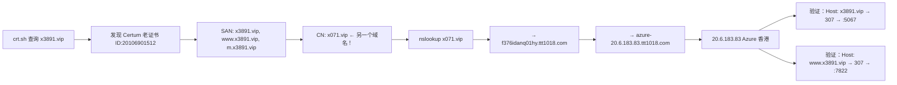

# CDN Origin IP 发现 — 历史SSL证书SAN逆向分析

## 原理

当一个目标域名被 CDN 保护后，其 DNS A 记录只返回 CDN 节点 IP。但**如果该域名曾在老SSL证书中与其他域名共享 SAN（Subject Alternative Name）**，且这些共享域名现在未通过同一CDN保护（或不再使用CDN），则解析共享域名即可直接得到源站IP。

**核心洞察**：SSL证书一旦签发，其SAN列表永久记录在 Certificate Transparency 日志中（crt.sh）。即使域名的当前证书SAN列表已经改变，历史证书仍可查询。

## 适用场景

- 目标域名被 CDN 保护（Cloudflare / jkydns / MJCDN 等）
- 直接 DNS 查询只返回 CDN 节点 IP
- 目标域名有时间换过 SSL 证书（Let's Encrypt 90天有效期意味着每季度换一次）
- 如果目标域名曾经和其他域名共用过同一个证书，该证书上的其他域名就是突破口

## 操作流程

### 第1步：从 crt.sh 获取所有历史证书

```bash
# 查询包含目标域名的所有证书（含过期）
curl -s "https://crt.sh/?q=%.x3891.vip&output=json" | python3 -c "
import json, sys
data = json.load(sys.stdin)
for entry in data:
    nv = entry.get('name_value', '')
    cn = entry.get('common_name', '')
    print(f'ID:{entry.get(\"id\",\"\")} CN:{cn} Issuer:{entry.get(\"issuer_name\",\"\")[-30:]}')
    print(f'  SAN: {nv}')
    print(f'  Valid: {entry.get(\"not_before\",\"\")} → {entry.get(\"not_after\",\"\")}')
    print(f'  Serial: {entry.get(\"serial_number\",\"\")}')
    print()
"
```

**执行要点**：
- `%` 是 crt.sh 的 URL 通配符，需 URL 编码为 `%25` 或在 JSON 模式中直接用 `%`
- 输出 JSON 格式更易解析；也可用 `output=html` 浏览器查看
- **特别注意非 Let's Encrypt 的证书**（如 Certum / DigiCert / Comodo）——这些是付费证书，有效期长（1年），常用于 CDN 部署前的裸源站

### 第2步：找出共享 SAN 的关联域名

```python
import json, sys
data = json.load(sys.stdin)
names = set()
for entry in data:
    nv = entry.get('name_value', '')
    for n in nv.split('\\n'):
        n = n.strip()
        if n and 'x3891.vip' not in n:  # 排除目标域名本身
            names.add(n)
for n in sorted(names):
    print(n)
```

### 第3步：解析关联域名

```bash
nslookup related-domain.com
nslookup related-domain.com 8.8.8.8
```

**注意**：如果关联域名也通过 CDN 保护，则 DNS 继续返回 CDN IP。但关联域名可能：
- 已不再使用 CDN（裸源站）
- 使用不同 CDN（另一个接入点）
- 已关闭/不再解析（如果关联的是随机生成的子域名，则这条路不通）

### 第4步：验证 IP 是否为源站

```bash
# 用关联域名的 Host header 访问该 IP
curl -skI --connect-timeout 5 -H "Host: related-domain.com" "https://IP_ADDRESS:443/"

# 用目标域名的 Host header 访问
curl -skI --connect-timeout 5 -H "Host: target.com" "https://IP_ADDRESS:443/"
```

**确认信号**：

| 响应特征 | 含义 | 确认为源站？ |
|:---------|:-----|:------------|
| 返回与 CDN 访问一致的内容（如 SPA HTML） | ✅ 该IP就是源站 | **确定** |
| OpenResty 307 重定向到内部端口（如 5067） | ✅ IP 认识该 Host header | **非常可能** |
| OpenResty 402 Payment Required | ✅ IP 有内容门控 | **很可能** |
| 400 Bad Request / nginx default page | ❌ IP 不认识该 Host | **不是** |
| SSL handshake error | ⚠️ TLS 在 CDN 终止，源站无有效证书 | **可能是** |

**OpenResty 307 重定向特例**：如果到源站 IP 返回：
```
HTTP/1.1 307 Temporary Redirect
Location: https://target.com:5067/
```
这说明源站使用 OpenResty 做应用层路由，不同 Host header 映射到不同后端端口。这是**强确认信号**——因为只有真实的源站服务器才知道这些路由规则。

### 第5步：确认 SSL 证书（可选）

```bash
# 验证该 IP 上是否有关联域名的有效证书
echo | openssl s_client -connect IP:443 -servername related-domain.com 2>&1 | \
  openssl x509 -noout -subject -issuer -dates -ext subjectAltName
```

## 实战案例：x3891.vip → 20.6.183.83



**关键突破点**：Certum 证书（2025-08-04 签发，有效期1年）的 CN 是 `x071.vip`，这是一个独立的第三方域名，当时与 x3891.vip 一起部署在同一台服务器上。该域名当前解析到 Azure IP 且不再使用 CDN，直接暴露了源站。

## 注意事项

| # | 说明 |
|:--|:-----|
| 1 | **优先关注非 LE 证书**——Let's Encrypt（90天有效期）是免费证书，CDN 切换后会自动更新。付费证书（Certum / DigiCert / Sectigo 等，1年有效期）更可能在裸源站上使用过 |
| 2 | **关注证书的 CN（Common Name）而非 SAN**——CN 通常是主域名，如果 CN 与目标域名不同，该 CN 域名就是关联突破口 |
| 3 | **随机生成的子域名没有价值**——如果 SAN 中的其他域名也是同样的随机字符串（如 `fiicm1t0mhwm4stbg6sadpp.xxx.x3891.vip`），它们都在同一域下，无法提供新IP |
| 4 | **crt.sh 有速率限制**——大量请求会被限流，建议间隔 1-2 秒 |
| 5 | **多 Issuer 检查**——同一域名在不同时期可能用不同 CA 签的证书，每个证书的 SAN 列表都不同。把所有 Issuer 的证书都查一遍 |

## 配合使用

此方法与其他 CDN 源站发现技术配合使用效果最佳：

- Cloudflare DNS 链追踪（见 SKILL.md CDN 源站 IP 发现章节）
- 全端口扫描 + HTTP 服务探测
- jkydns / MJCDN 等专用 DNS 解析器分析
- 子域名 DNS 爆破
